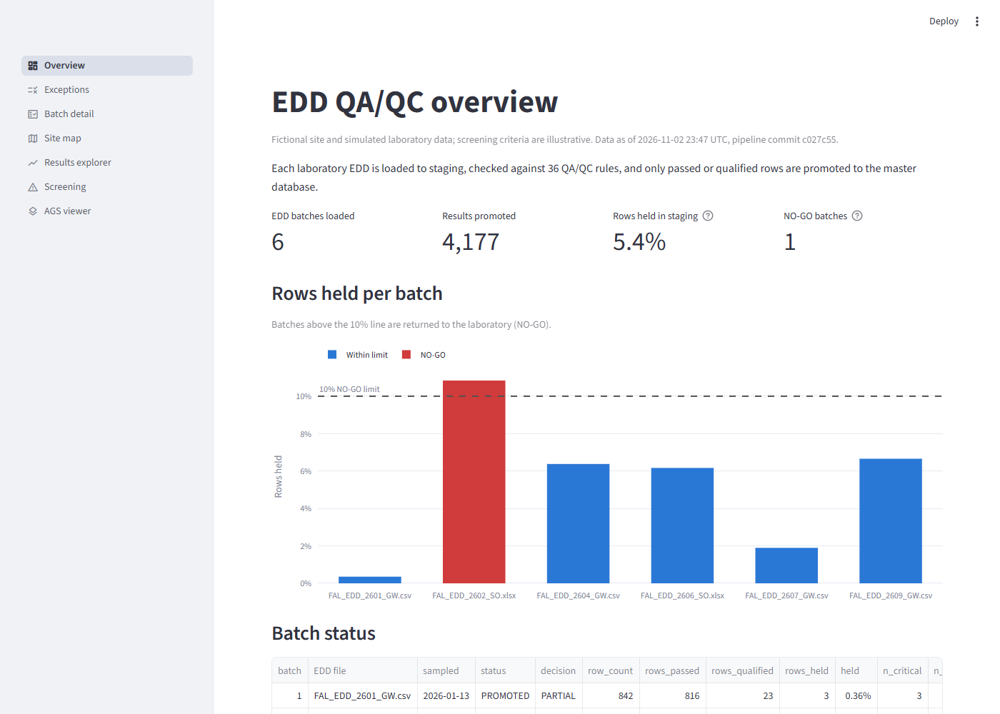
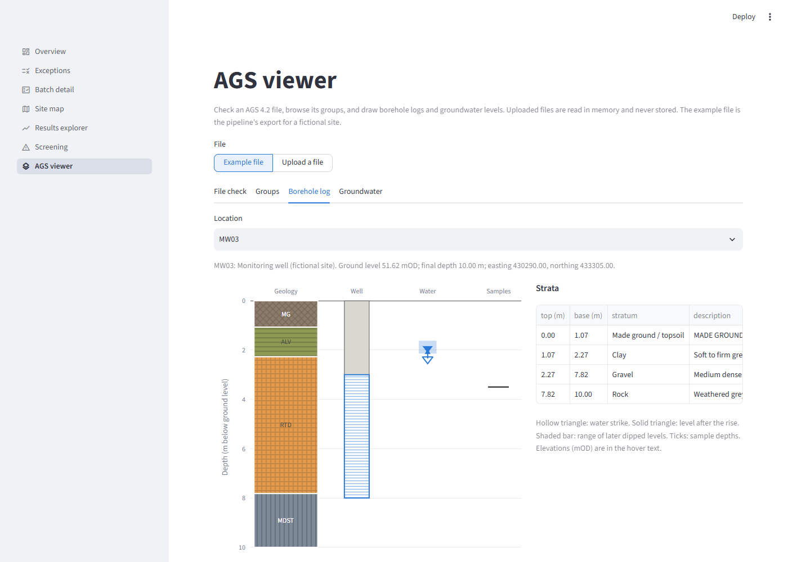
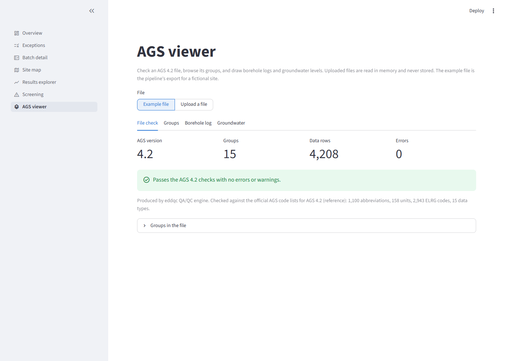
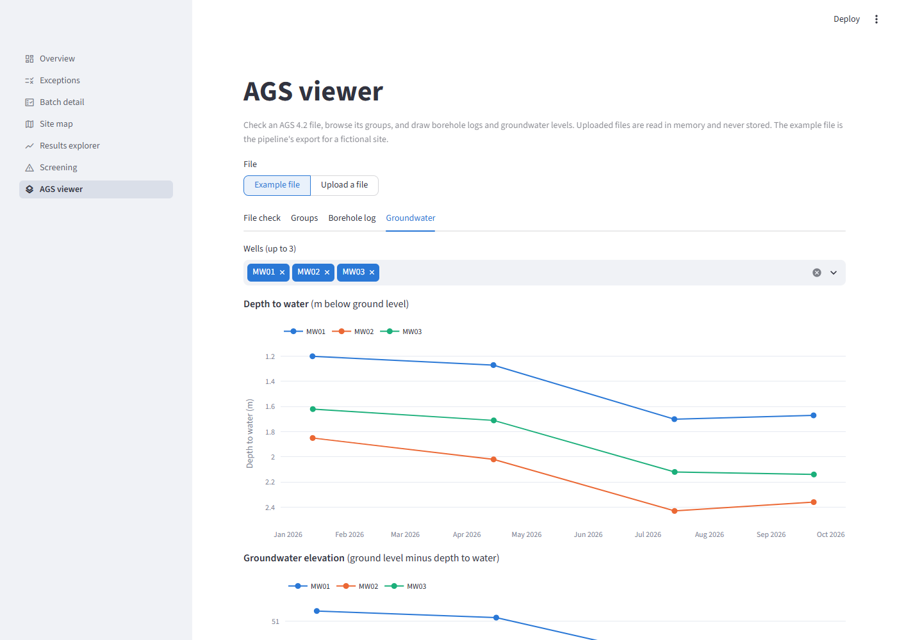

# EDD QA/QC Dashboard

A Streamlit dashboard for the [Automated Environmental QA/QC & EDD Validation Engine](https://github.com/PriyankaSagwekar/EDD-Validation-Engine-and-QA-QC). It shows how laboratory EDDs fared against 36 automated QA/QC rules, where on site the problems are, and how validated results compare with UK screening criteria. An AGS viewer page checks any AGS 4.2 file and draws borehole logs and groundwater levels from it.

**Live demo:** _link added after deployment_

> The site, laboratory and data are fictional and simulated. Screening criteria are illustrative values, not for real assessment.

## Pages

| Page | What it answers |
|---|---|
| Overview | How many EDDs were loaded, how much was promoted, which batches were NO-GO |
| Exceptions | Which rules failed, filtered by file, family, severity and rule, with CSV download |
| Batch detail | The import decision for one EDD, qualifiers applied and rows held in staging |
| Site map | QC status (RAG) of every borehole, well and trial pit |
| Results explorer | Concentrations over the monitoring rounds, non-detects at the RL, criterion line |
| Screening | Worst exceedance per location and a location × analyte heatmap per criteria set |
| AGS viewer | Upload an AGS 4.2 file (or use the example): format and code-list check, every group as a table, a borehole log per location, and groundwater levels over time |

## Screenshots

| Overview | AGS viewer: borehole log |
|---|---|
|  |  |
| **AGS viewer: file check** | **AGS viewer: groundwater levels** |
|  |  |

## How the data gets here

```
Pipeline repo (laptop)                         This repo
SQL Server EnvDataQC  ── scripts/refresh_data.py ──►  data/envdataqc.duckdb + data/manifest.json
  reporting views (vw_*)                               │ git push
                                                       ▼
                                          Streamlit Community Cloud → public URL
```

- The hosted app never connects to SQL Server. It reads a DuckDB snapshot of the pipeline's reporting views, committed in `data/`.
- `refresh_data.py` copies each view in full, converts British National Grid coordinates to WGS84 for web maps, and writes `manifest.json` (time, pipeline commit, row counts, schema version). The app shows the "data as of" time on every page.
- The import decision on the Batch detail page uses the same rule and threshold as the pipeline's Excel report.

## Run locally

```powershell
python -m venv .venv
.\.venv\Scripts\python.exe -m pip install -r requirements-dev.txt
.\.venv\Scripts\python.exe scripts\refresh_data.py          # needs the pipeline's SQL Server
.\.venv\Scripts\python.exe scripts\sync_ags.py              # after AGS code or code-list changes in the pipeline
.\.venv\Scripts\python.exe -m streamlit run app.py
.\.venv\Scripts\python.exe -m pytest
```

To update the hosted site after new EDDs have been run through the pipeline:

```powershell
.\.venv\Scripts\python.exe scripts\refresh_data.py --push
```

## AGS viewer

- **Only AGS 4.2 files are accepted.** A file that declares another version, or has no TRAN group, is rejected with a message. The pipeline itself still loads AGS 4.0 and 4.1 files, with a warning.
- **Checks** cover the AGS 4.2 file rules (ASCII, CR+LF line ends, quoting, key and required headings, parent records, ABBR/UNIT/TYPE/DICT declarations) and the official AGS code lists. Each code or unit is reported by its AGS status: Approved is fine, Accepted is a note, Proposed and Deprecated are warnings, Declined is an error.
- **Borehole log**: geology from GEOL (coloured and hatched by the AGS legend code), the well screen from MONG, water strikes and their rise from WSTG/WSTD, the range of dipped levels from MOND, and sample depths from SAMP. Depths are in metres below ground level; elevations (mOD) are in the hover text.
- **Groundwater**: MOND depth-to-water readings (`WDEP`) over time, groundwater elevation, and a map of the locations (British National Grid converted to WGS84).
- Files with missing groups still open; the affected tab says what is missing. Uploads (up to 20 MB) are read in memory and never stored.
- The example file is the pipeline's AGS export for the fictional site, copied by `refresh_data.py`.

**Where the AGS code comes from.** `lib/ags/` holds unedited copies of the pipeline's AGS parser and checker and of the AGS code lists, made by `scripts/sync_ags.py`. `lib/ags/SYNC.json` records the pipeline commit and a hash of each file, and a test fails if a copy is edited or falls behind the pipeline. The code lists are © the Association of Geotechnical and Geoenvironmental Specialists; see `lib/ags/reference/SOURCE.md`.

## ArcGIS Online maps

The Site map, Results explorer and Screening pages embed ArcGIS Online items when their URLs are set in `config/maps.toml`. Until then they show a built-in map drawn from the same data. See the pipeline repo's `docs/ARCGIS_GUIDE.md` for building the maps from `site_qc.gpkg`.

## Deploy (Streamlit Community Cloud)

1. Push this repo to GitHub.
2. At share.streamlit.io choose **Create app**, select this repo, branch `main`, main file `app.py`.
3. The app installs `requirements.txt` only. It does not need any secrets.

Free apps go to sleep when unused and take about 30 seconds to wake.
